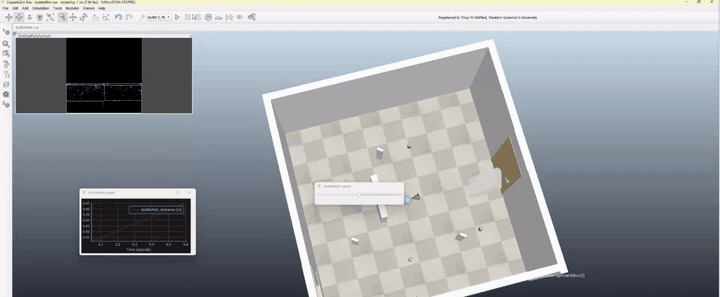
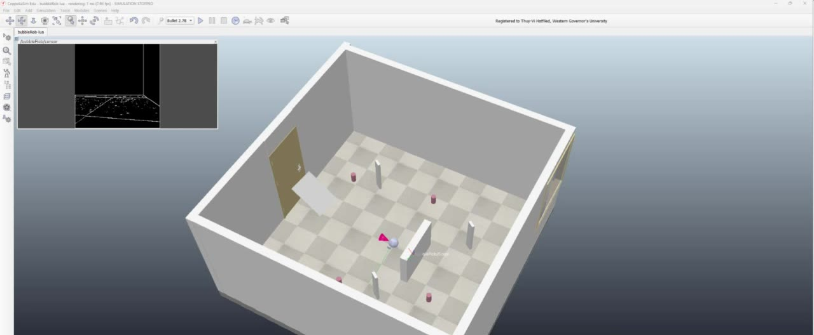
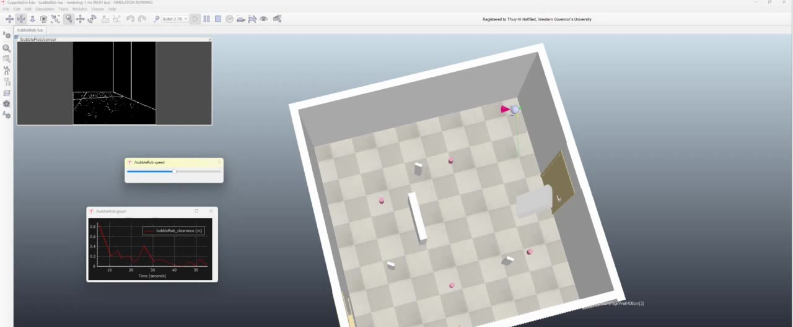
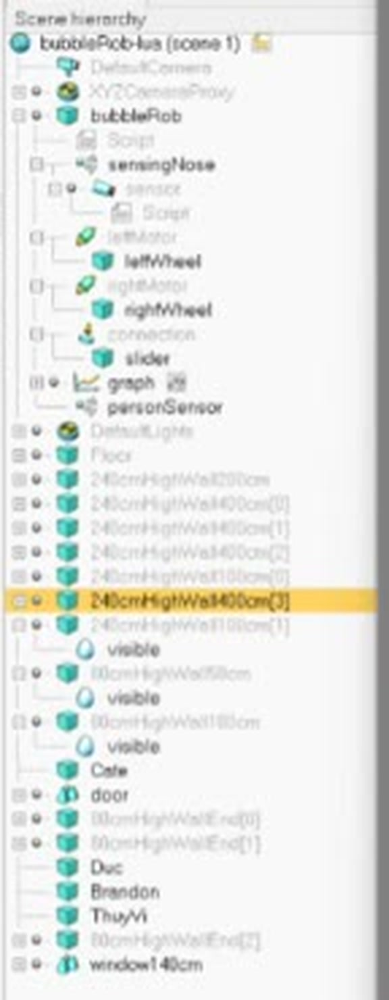

# Disaster Relief Robot

An autonomous search-and-rescue prototype built in [CoppeliaSim](https://www.coppeliarobotics.com/) by extending the stock **BubbleRob** tutorial robot. The robot explores a classroom damaged by an earthquake, avoids debris, and reports each trapped survivor it finds.

Originally built for **WGU course C951:** Introduction to Artificial Intelligence.



## The problem

After a major earthquake, first responders often can't safely enter a damaged building: the structure may be unstable, debris is sharp and shifting, and aftershocks are possible. A small robot can go in first, sweep the space, and tell rescuers **where people are** and **what is in the way** before anyone is put at risk.

## The environment

A single classroom with:

- a **collapsed bookshelf** lying across the floor, creating a narrow passage between the entrance and the middle of the room
- **scattered debris** (overturned desks, chairs and ceiling fragments, modelled as blocks) that forces the robot to find alternate routes
- **four survivors**, modelled as pink cylinders

| Scene overview | Running, with speed slider and clearance graph |
| --- | --- |
|  |  |

## Robot design

Changes made to the default BubbleRob:

| Component | Purpose |
| --- | --- |
| Front cone proximity sensor (`sensingNose`) | Detects obstacles ahead. On a hit, the robot backs up in a curve for 3 seconds, then resumes driving forward. |
| Ray proximity sensor (`personSensor`) | Stands in for a thermal sensor. When it detects a survivor object, the robot prints a message and remembers that person was found. |
| Vision sensor (`sensor`) | Live camera view of what the robot sees (shown in the top-left pane of the screenshots). |
| Drawing objects (`robotTrace`, `distanceSegment`) | Draw the robot's path and the line to the nearest obstacle. |
| Graph (`bubbleRob clearance`) | Plots the robot's distance to the nearest obstacle over time. |
| Speed slider (simUI) | Adjusts motor speed between 50 and 300 deg/s while the simulation runs. |


## How it maps to AI concepts

- **Reasoning.** Sensor input drives conditional logic: if the nose sensor sees an obstacle, the robot concludes that moving forward means a collision and switches to reverse-and-turn.
- **Knowledge representation.** Each survivor has a `found` flag (see the `survivors` table in `src/bubbleRob.lua`). The robot uses these to avoid reporting the same person twice and to keep a running head count.
- **Memory of the environment.** `backUntilTime` gives the robot short-term memory of a recent obstacle. The path trace and clearance graph give responders a picture of where the robot has been.
- **Uncertainty.** The sensors only see a narrow cone or ray in front of or beside the robot, so the robot never has a full picture of the room. It acts on partial, changing information.
- **Intelligence.** It follows no fixed path. It senses, decides and adapts, and it searches without constant human control.

## Scene setup

> **The original CoppeliaSim scene file (`.ttt`) was lost, so it is not included.** The GIF, screenshots and demo video show the full run, and the script in `src/` can be run on a rebuilt scene using the checklist below.

This is the scene hierarchy as it appeared in the demo (screenshot taken from the video, so it is a little soft):

<table>
<tr>
<td valign="top" width="260">
<a href="media/scene-hierarchy.jpg"></a>
</td>
<td valign="top">
<pre>
bubbleRob-lua (scene 1)
├── DefaultCamera
├── XYZCameraProxy
├── bubbleRob
│   ├── Script
│   ├── sensingNose
│   │   └── sensor
│   │       └── Script
│   ├── leftMotor
│   │   └── leftWheel
│   ├── rightMotor
│   │   └── rightWheel
│   ├── connection
│   │   └── slider
│   ├── graph
│   └── personSensor
├── DefaultLights
├── Floor
├── 240cmHighWall200cm
├── 240cmHighWall400cm[0]
├── 240cmHighWall400cm[1]
├── 240cmHighWall400cm[2]
├── 240cmHighWall100cm[0]
├── 240cmHighWall400cm[3]
├── 240cmHighWall100cm[1]
│   └── visible
├── 80cmHighWall50cm
│   └── visible
├── 80cmHighWall100cm
│   └── visible
├── door
├── 80cmHighWallEnd[0]
├── 80cmHighWallEnd[1]
├── Cate
├── Duc
├── Brandon
├── ThuyVi
├── 80cmHighWallEnd[2]
└── window140cm
</pre>
</td>
</tr>
</table>

### Object checklist

The script looks these objects up by name, so they must match exactly.

| Object | Where | Role |
| --- | --- | --- |
| `bubbleRob` | scene root | Robot body. The script is attached to it as a child script. |
| `leftMotor`, `rightMotor` | children of `bubbleRob` | Joints that drive the wheels (`leftWheel`, `rightWheel`). |
| `sensingNose` | child of `bubbleRob` | Pink cone proximity sensor at the front, for obstacles. |
| `personSensor` | child of `bubbleRob` | Green ray proximity sensor on the left side (about 1 m range), for survivors. |
| `graph` | child of `bubbleRob` | Graph that plots the clearance stream. |
| `Cate`, `Duc`, `Brandon`, `ThuyVi` | scene root | Pink cylinders standing in for survivors. |
| Walls, floor, door, window | scene root | Classroom shell, built from wall blocks, e.g. `240cmHighWall400cm[0..3]`, `80cmHighWallEnd[0..2]`, `door`, `window140cm`. |
| Debris and fallen shelf | scene root | Extra blocks placed to create the narrow passage and scattered obstacles. |

The robot also has a vision sensor named `sensor`; its camera view is the small pane in the top-left of the screenshots.

### Rebuilding it

1. Install [CoppeliaSim](https://www.coppeliarobotics.com/) (the Edu build was used for the demo) and open its stock BubbleRob tutorial scene.
2. Build the classroom from walls and a floor, then add a few blocks as the fallen bookshelf and debris.
3. Add four cylinders at the scene root named `Cate`, `Duc`, `Brandon` and `ThuyVi`.
4. Add the `personSensor` ray sensor and the `graph` as children of `bubbleRob`, with the names above.
5. Paste `src/bubbleRob.lua` into the robot's child script and press **Play**. Reported survivors appear in the console at the bottom of the window.

## Limitations

- Survivors are recognised by comparing object handles, which simulates thermal detection rather than doing real perception.
- Behaviour is purely reactive. The robot keeps no map, so it can revisit the same areas and has no guarantee of covering the room.
- Obstacle response is a fixed rule (reverse for 3 seconds), not something the robot has learned.

## Roadmap

- **Reinforcement learning.** Reward finding survivors and collision-free movement; penalise collisions and getting stuck. The robot could then learn which movement patterns work instead of relying on hand-written rules.
- **Search and coverage.** Keep a map of visited areas and prioritise unexplored regions, using an algorithm such as frontier-based exploration or A* to the nearest unvisited area, so every part of the room is checked efficiently.
- **Richer sensing.** Real thermal and camera input in place of handle matching.

## Repository layout

```
.
├── README.md
├── src/
│   ├── bubbleRob.lua                  cleaned-up robot script
│   └── original/bubbleRob_submitted.lua   script exactly as submitted
├── scene/                             notes on the scene (.ttt not included)
├── media/                             GIF and screenshots
└── docs/                              demo video link and notes
```

## License

MIT. See [LICENSE](LICENSE).
